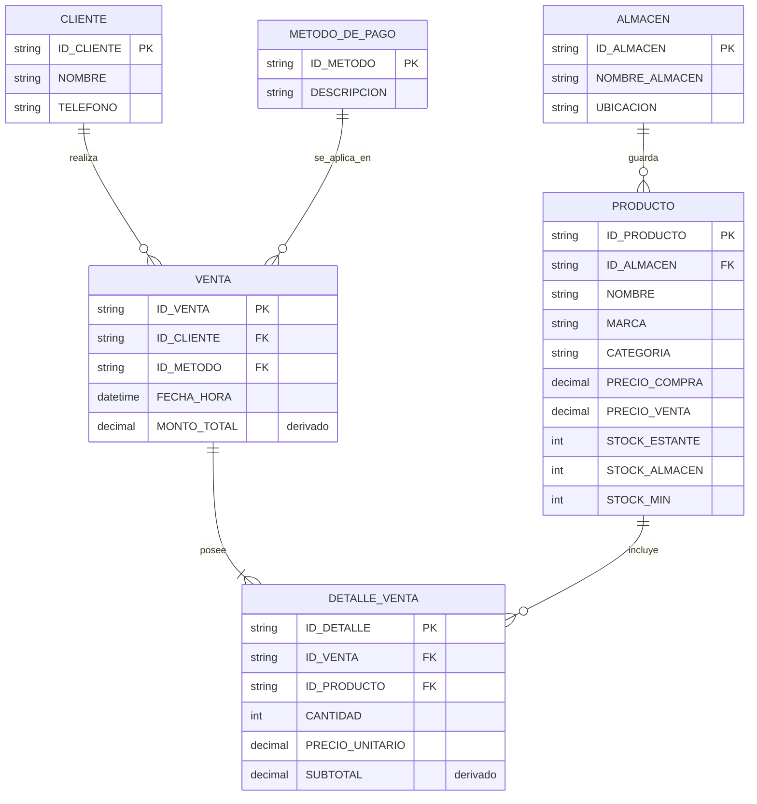
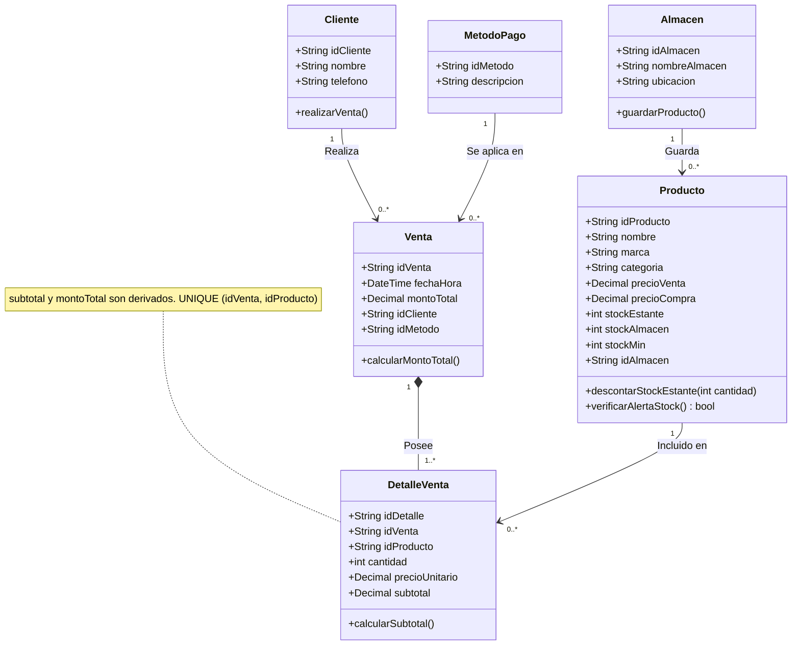

# 🛒 Sistema de Gestión de Inventario y Ventas — Tienda "Natalia"

Sistema de control de inventario y registro de ventas enfocado en comercios minoristas de venta directa al contado. El proyecto resuelve la necesidad de trazabilidad de productos entre exhibición y depósito, gestión de clientes sin fines de facturación tributaria y automatización de alertas de reabastecimiento.

---

## 📄 Vista General del Proyecto

* **Módulo Principal (Core):** Gestión de ventas diarias al contado (Efectivo y QR), registro de clientes para historial de compras e integración de detalles de venta con precios congelados al momento de la venta.
* **Módulo Secundario:** Gestión de inventario multinivel (diferenciando `STOCK_ESTANTE` y `STOCK_ALMACEN`) y alertas de stock mínimo para compras mayoristas.
* **Materia:** INF312 — Base de Datos I.

### Contenido de la carpeta

| Archivo | Descripción |
|---|---|
| `README.md` | Resumen del proyecto, modelo de datos y reglas de negocio (este archivo). |
| `base_de_datos1.md` | Documentación conceptual: narración del cliente, suposiciones, entidades y DER. |
| `normalizacion.md` | Proceso de normalización de 0FN a 3FN con tablas de ejemplo. |

---

## 📝 Documentación Conceptual (`base_de_datos1.md`)

### Narración del Cliente
> *"Soy la Sra. Natalia Guzmán, propietaria de la Tienda Natalia. Vendo papelería y artículos variados. Al ser un negocio de venta minorista al por menor, todas nuestras ventas son al contado (efectivo o QR) y no emitimos facturas fiscales. Actualmente anoto todo en un cuaderno borrador cuando voy a comprar mercadería a los mercados mayoristas para saber a cuánto debo vender la unidad. Necesito un sistema para controlar el stock de los productos que tengo exhibidos en los estantes y en el depósito o almacén de respaldo. Para cada venta se debe registrar un cliente para llevar un control e historial de compras, aunque no se emita factura por el tipo de negocio minorista. Necesito registrar el nombre, marca, categoría, precio de compra, precio de venta, las unidades en estante y en almacén. Al final del día quiero saber cuánto vendí en total, cuánto cobré en efectivo, cuánto por QR y qué productos tuvieron más salida. Además, necesito que el sistema me avise cuando a un producto le queden pocas unidades para incluirlo en mi lista de compras."*

### Suposiciones del Dominio
1. **Facturación e historial:** No se emiten facturas fiscales debido a la modalidad de comercio minorista de venta rápida. Se incluye la entidad `CLIENTE` para mantener la trazabilidad e historial comercial.
2. **Control de inventario:** Se dividen las existencias en `STOCK_ESTANTE` (disponibilidad para venta inmediata) y `STOCK_ALMACEN` (depósito de reserva).
3. **Persistencia de precios:** El precio unitario se fija en el momento exacto del registro en `DETALLE_VENTA`, para conservar el valor histórico frente a futuros cambios de `PRECIO_VENTA` en `PRODUCTO`.
4. **Cliente obligatorio y "Cliente mostrador":** Como cada venta exige un cliente (cardinalidad 1..1), se registra un cliente genérico llamado `CLIENTE MOSTRADOR` para las ventas en las que la persona no desea dar sus datos.
5. **Un solo almacén por producto:** `STOCK_ALMACEN` se guarda dentro de `PRODUCTO`, por lo que cada producto se custodia en un único almacén (`ID_ALMACEN`). Si en el futuro hubiera varios depósitos con el mismo producto, se crearía una tabla `INVENTARIO (ID_PRODUCTO, ID_ALMACEN, STOCK)`.
6. **Atributos derivados:** `SUBTOTAL` (`CANTIDAD` × `PRECIO_UNITARIO`) y `MONTO_TOTAL` (suma de los subtotales de la venta) se pueden recalcular, pero se conservan para agilizar el reporte de cierre del día. El sistema debe mantenerlos consistentes al registrar cada venta.
7. **Identificadores:** Los IDs son códigos de texto (por ejemplo `CLI01`, `M01`, `A01`, `P10`, `V001`, `D01`).

---

## 📊 Modelo Entidad-Relación (DER)

Entidades, atributos, claves primarias (PK), claves foráneas (FK) y cardinalidades del sistema:

> 📌 *Versión en imagen del DER:* se puede colocar aquí el diagrama exportado desde draw.io.

---

## 🧩 Diagrama de Clases (UML)

---

## 🗄️ Esquema de Entidades y Relaciones

| Entidad | Clave primaria | Atributos | Claves foráneas |
|---|---|---|---|
| `CLIENTE` | `ID_CLIENTE` | `NOMBRE`, `TELEFONO` | — |
| `METODO_DE_PAGO` | `ID_METODO` | `DESCRIPCION` | — |
| `ALMACEN` | `ID_ALMACEN` | `NOMBRE_ALMACEN`, `UBICACION` | — |
| `PRODUCTO` | `ID_PRODUCTO` | `NOMBRE`, `MARCA`, `CATEGORIA`, `PRECIO_COMPRA`, `PRECIO_VENTA`, `STOCK_ESTANTE`, `STOCK_ALMACEN`, `STOCK_MIN` | `ID_ALMACEN` → `ALMACEN` |
| `VENTA` | `ID_VENTA` | `FECHA_HORA`, `MONTO_TOTAL` (derivado) | `ID_CLIENTE` → `CLIENTE`, `ID_METODO` → `METODO_DE_PAGO` |
| `DETALLE_VENTA` | `ID_DETALLE` | `CANTIDAD`, `PRECIO_UNITARIO`, `SUBTOTAL` (derivado) | `ID_VENTA` → `VENTA`, `ID_PRODUCTO` → `PRODUCTO` |

**Restricción adicional:** `UNIQUE (ID_VENTA, ID_PRODUCTO)` en `DETALLE_VENTA`, para que un producto no se repita como renglón dentro de la misma venta (equivale a la clave compuesta definida en 1FN).

### Cardinalidades Justificadas
* **`CLIENTE` (0..N) — `REALIZA` — (1..1) `VENTA`:** Un cliente puede realizar varias ventas (o ninguna aún); cada venta pertenece a un único cliente.
* **`METODO_DE_PAGO` (0..N) — `SE_APLICA_EN` — (1..1) `VENTA`:** Un método de pago puede usarse en muchas ventas; cada venta tiene un único método.
* **`ALMACEN` (0..N) — `GUARDA` — (1..1) `PRODUCTO`:** Un almacén custodia varios productos (o ninguno todavía); cada producto está asignado a un único almacén.
* **`VENTA` (1..1) — `POSEE` — (1..N) `DETALLE_VENTA`:** Una venta se compone de uno o varios renglones; cada detalle pertenece a una única venta.
* **`PRODUCTO` (1..1) — `INCLUYE` — (0..N) `DETALLE_VENTA`:** Un producto puede aparecer en muchos detalles de venta (o en ninguno si aún no se vendió); cada detalle corresponde a un único producto.

---

## 📐 Normalización

El proceso completo (0FN → 1FN → 2FN → 3FN), con tablas de ejemplo y la justificación de los atributos derivados y del precio unitario, está en [`normalizacion.md`](normalizacion.md).

**Resultado en 3FN:** `CLIENTE`, `METODO_DE_PAGO`, `ALMACEN`, `PRODUCTO`, `VENTA` y `DETALLE_VENTA`.

---

## ⚙️ Reglas de Negocio Implementadas

1. **Validación de unidades:** La cantidad ingresada en `DETALLE_VENTA` se valida contra el saldo de `STOCK_ESTANTE`.
2. **Deducción automática:** Cada registro en `DETALLE_VENTA` decrementa automáticamente la existencia en `STOCK_ESTANTE`.
3. **Alerta de reabastecimiento:** Si `STOCK_ESTANTE` $\le$ `STOCK_MIN`, el sistema notifica la necesidad de reponer el estante. Si `STOCK_ALMACEN` tiene unidades, se sugiere una transferencia del almacén al estante; si `STOCK_ESTANTE + STOCK_ALMACEN` $\le$ `STOCK_MIN`, el producto se incluye en la lista de compras mayoristas.
4. **Cierre del día:** El sistema permite consultar el total vendido, el total cobrado en efectivo, el total cobrado por QR y los productos con mayor salida.

